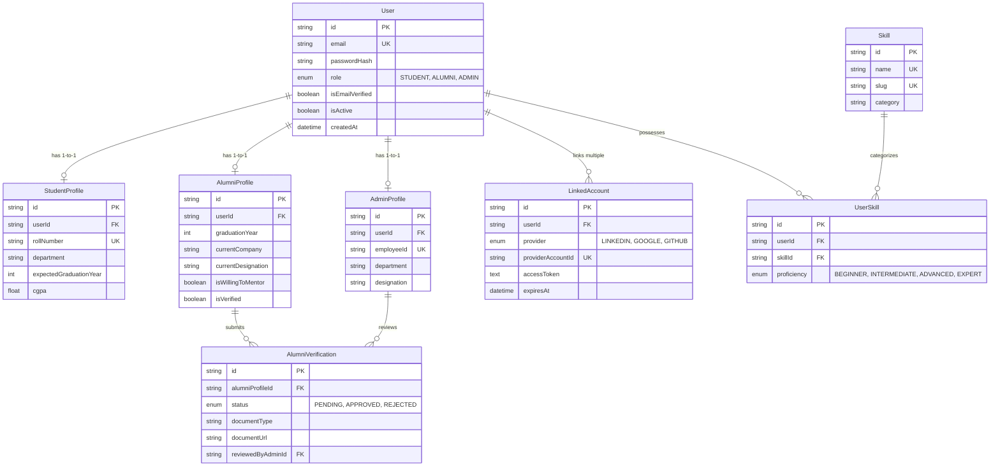

# Alumni Connect - System Architecture & Design Specification

## 1. Architectural Philosophy

Alumni Connect is engineered as a robust, institutional-grade professional networking platform. It operates under strict security, privacy, and architectural guidelines:
- **Relational Integrity**: Built entirely on **MySQL 8** (InnoDB) and managed via **Prisma ORM**. No NoSQL/MongoDB is used.
- **Strict Typing**: Full end-to-end TypeScript strict mode across both `client` and `server`.
- **Runtime Validation**: API boundaries validated via **Zod schemas** to guarantee runtime type safety before database queries.
- **Fail-Safe Observability**: Separate diagnostic checks for Node.js process runtime and MySQL database availability.

---

## 2. Monorepo Organization

```
Alumni Connect/
├── package.json               # Root workspaces configuration & concurrent scripts
├── .gitignore                 # Enforces security; blocks .env, secrets, node_modules
├── .env.example               # Root environment variable template
├── README.md                  # Developer quickstart & execution guide
├── docs/
│   ├── ARCHITECTURE.md        # This specification document
│   └── LINKEDIN_INTEGRATION.md# LinkedIn OAuth 2.0 / OIDC architecture
├── server/
│   ├── package.json
│   ├── tsconfig.json          # NodeNext / CommonJS strict TypeScript config
│   ├── .env.example
│   ├── prisma/
│   │   ├── schema.prisma      # Relational schema (User, Profiles, Verifications, Skills)
│   │   └── seed.ts            # Development database seed script
│   └── src/
│       ├── config/            # Environment validation & Prisma client singleton
│       ├── controllers/       # Health and authentication route controllers
│       ├── middleware/        # Centralized error handler, 404 handler
│       ├── routes/            # Modular Express routing
│       ├── services/          # LinkedIn OIDC, Nodemailer, Cloudinary stubs
│       ├── utils/             # Standard API response wrappers & AppError classes
│       ├── app.ts             # Express application assembly
│       └── server.ts          # HTTP server & Socket.IO initialization
└── client/
    ├── package.json
    ├── tsconfig.json          # Bundler strict TypeScript config
    ├── vite.config.ts         # Vite bundler with @ path alias & /api proxy
    ├── tailwind.config.js     # Deep navy primary & slate design tokens
    ├── index.html
    └── src/
        ├── components/
        │   ├── ui/            # Reusable UI primitives (Button, Card, Badge, Input)
        │   ├── common/        # Shared shell (Navbar with live DB status, Footer)
        │   └── landing/       # Modular high-conversion landing page sections
        ├── pages/
        │   ├── LandingPage.tsx
        │   ├── LoginPage.tsx
        │   ├── RegisterPage.tsx
        │   ├── dashboards/    # Role portals: Student, Alumni, Admin
        │   └── NotFoundPage.tsx
        ├── lib/               # API clients & utility helpers
        ├── App.tsx            # React Router & React Query provider
        └── main.tsx           # React DOM root entry
```

---

## 3. Relational Schema ER Model (MySQL 8)



---

## 4. UI/UX Design System Direction

- **Primary Colors**: Deep Navy (`#071526` / `#0F2744`) representing institutional prestige and academic trust.
- **Accent Blues**: Modern Electric Blues (`#2563EB` / `#3B82F6`) for interactive affordances and key actions.
- **Neutral Grounds**: Slate and Cool Greys (`#F8FAFC`, `#F1F5F9`, `#E2E8F0`) providing visual separation without harsh contrast.
- **Component Primitives**: Inspired by shadcn/ui and Radix design standards, prioritizing accessibility, contrast ratios, and keyboard navigation.

---

## 5. Security & Validation Standards

1. **Environment Strictness**: All environment parameters are validated on boot with `zod`. Missing or malformed variables crash the boot process immediately with actionable diagnostics rather than failing unpredictably in production.
2. **Centralized Error Handling**: Express middleware maps `ZodError`, Prisma unique constraint codes (`P2002`), and custom `AppError` instances to uniform JSON envelopes without leaking internal server stack traces in production.
3. **Password Security**: Passwords are hashed with `bcryptjs` using a minimum work factor of 10 rounds.
4. **Independent Health Diagnostics**: `/api/health` probes both the Node.js process and runs a `SELECT 1` ping against MySQL, reporting granular statuses so load balancers can make informed routing decisions.
