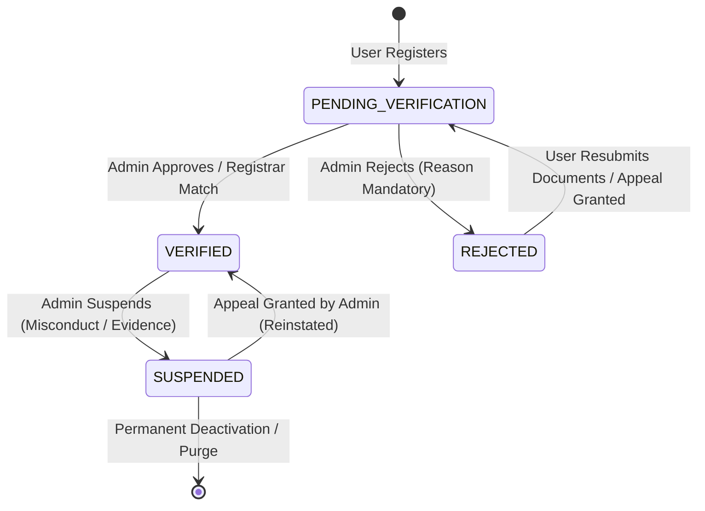
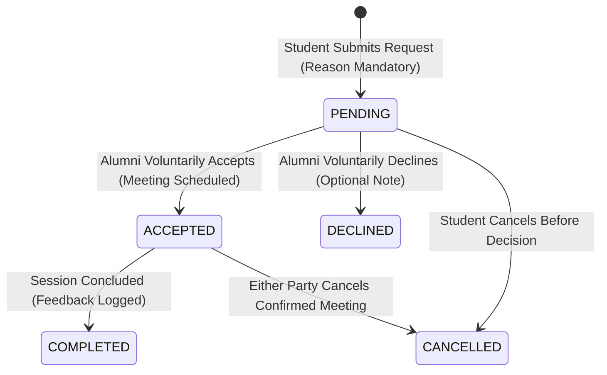
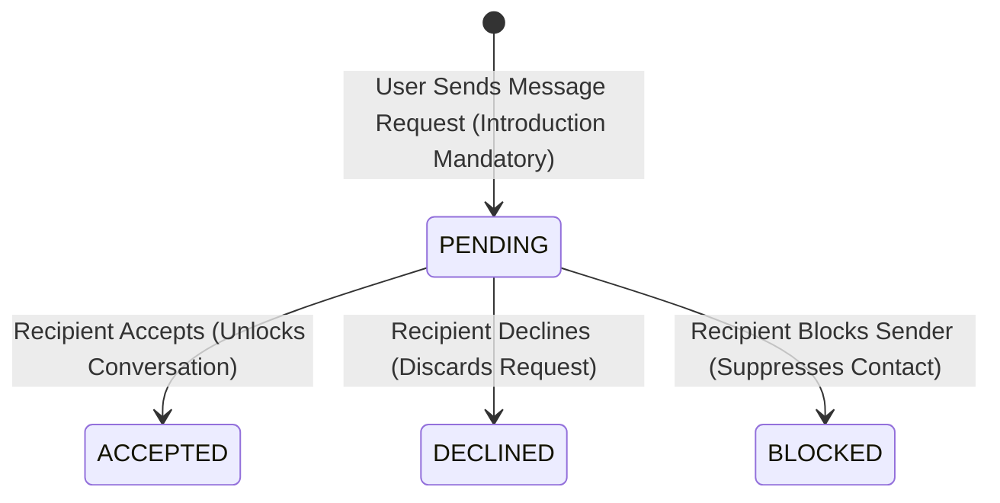
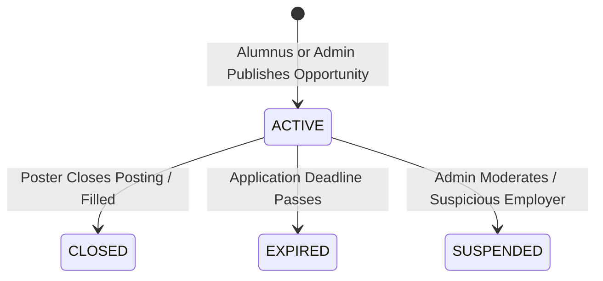
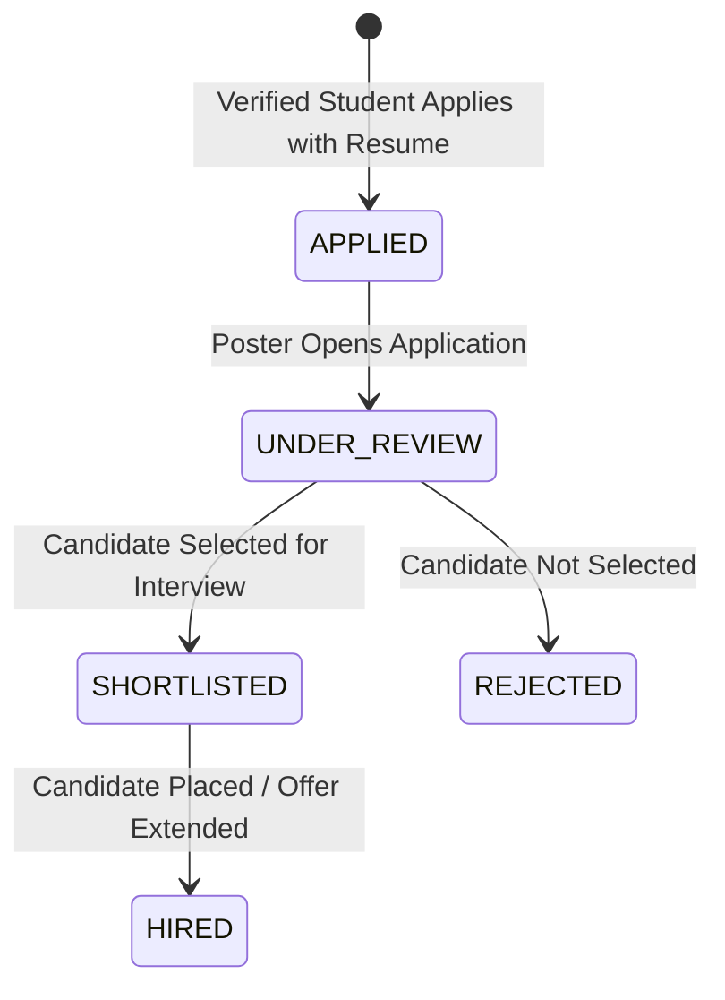

# Alumni Connect — Relational Business Rules & State Transition Specification

**Project:** Alumni Connect  
**Database Engine:** MySQL 8 (InnoDB Engine)  
**ORM Framework:** Prisma 6  
**Document Version:** 2.0 (Phase 2 Database Design)  
**Status:** Business Logic Specification (Awaiting Approval)  

---

## 1. Executive Summary

This document formalizes all database-enforced integrity constraints, lifecycle state machines, and relational business rules governing **Alumni Connect**. Every transition described herein must be enforced through database constraints, unique indexes, atomic Prisma transactions, or backend validation middleware.

---

## 2. Core Business Invariants

```
                                  [ THE 5 CARDINAL INVARIANTS ]
┌───────────────────────────────┬───────────────────────────────┬───────────────────────────────┐
│     VOLUNTARY SOVEREIGNTY     │       AUDIT IMMUTABILITY      │       ZERO AUTO-BANS          │
│ Alumni are NEVER required to  │ Administrative audit logs     │ Algorithmic suspicion scores  │
│ mentor, reply to messages, or │ are append-only. UPDATE and   │ only flag for human review;   │
│ post jobs.                    │ DELETE operations are barred. │ they never ban users.         │
├───────────────────────────────┴───────────────────────────────┴───────────────────────────────┤
│     TWO-TIER VERIFICATION     │       RESTRICTED ACCESS       │                               │
│ Both students and alumni must │ Unverified/pending accounts   │                               │
│ be verified before accessing  │ cannot send mentorship or     │                               │
│ protected networking tools.   │ message requests.             │                               │
└───────────────────────────────┴───────────────────────────────┘
```

---

## 3. Account Lifecycle & Status Transitions

### 3.1. User Status State Machine



### 3.2. Status Transition Rules

| Transition | Authorized Initiator | Relational Requirements & Side-Effects |
| :--- | :--- | :--- |
| **$\rightarrow$ `PENDING_VERIFICATION`** | Self (Registration) | `User` created with `status = PENDING_VERIFICATION`. Profile created (`StudentProfile` or `AlumniProfile`). Verification submission queued in `StudentVerification` or `AlumniVerification`. |
| **`PENDING` $\rightarrow$ `VERIFIED`** | Admin / CDC Coordinator | `reviewedByAdminId` and `reviewedAt` recorded. `User.status` updated to `'VERIFIED'`. Profile `isVerified` set to `true`. Welcome notification and email dispatched. `AdminAuditLog` recorded (`USER_APPROVE`). |
| **`PENDING` $\rightarrow$ `REJECTED`** | Admin / CDC Coordinator | `reviewNotes` **mandatory** (cannot be null or empty). `User.status` set to `'REJECTED'`. Profile `isVerified` remains `false`. User receives notification detailing why documents were rejected with resubmission guidance. `AdminAuditLog` recorded (`USER_REJECT`). |
| **`VERIFIED` $\rightarrow$ `SUSPENDED`** | Admin / CDC Coordinator | `reason` **mandatory** in `AdminAuditLog`. `User.status` set to `'SUSPENDED'`. User's active sessions invalidated. Active job postings and mentorship requests set to paused. User redirected to `/appeal` upon login. |
| **`SUSPENDED` $\rightarrow$ `VERIFIED`** | Admin / CDC Coordinator | Requires formal review of `AccountAppeal`. `resolutionVerdict` recorded. `User.status` restored to `'VERIFIED'`. `AdminAuditLog` recorded (`USER_REINSTATE`). Confirmation notification dispatched. |

---

## 4. Student & Alumni Verification Rules

### 4.1. Student Verification Rules
1. **USN Uniqueness:** `StudentProfile.rollNumber` must be unique across the entire institution (`UNIQUE INDEX`).
2. **Institutional Records Matching:** If the student's email domain matches `@university.edu`, email verification establishes immediate soft-verification; final verification requires USN match against the registrar's batch registry.
3. **Restricted Mode for Students:**
   - Allowed: Read public landing pages, edit own profile draft, view college circulars, browse alumni directory (view-only).
   - Prohibited until `VERIFIED`: Cannot send mentorship requests, cannot apply for jobs/internships, cannot post in community forums, cannot initiate message requests.

### 4.2. Alumni Verification Rules
1. **Degree & Batch Validation:** Graduation year, degree, and department must match institutional convocation records.
2. **Official LinkedIn OIDC Claim:** If the alumnus connects LinkedIn via OpenID Connect, the certified `sub` claim is recorded in `LinkedAccount`. This assists verification but does **not** bypass human admin sign-off for degree confirmation.
3. **Voluntary Participation Rules:**
   - Setting `isWillingToMentor = false` hides the "Request Mentorship" button on their public profile card.
   - Setting `maxMentees = N` ensures the platform automatically pauses inbound requests when active mentorship count reaches $N$.
   - Alumni may pause or resume mentorship at any time with immediate effect.

---

## 5. Mentorship Lifecycle & Relational Rules

### 5.1. Mentorship Request State Machine



### 5.2. Mentorship Business Rules
1. **Only Verified Students Can Request:** `req.user.status === 'VERIFIED'` and `req.user.role === 'STUDENT'`.
2. **Target Alumnus Must Be Open:** The recipient must have `isWillingToMentor === true`, `status === 'VERIFIED'`, and active mentee count $< \text{maxMentees}$.
3. **Mandatory Request Reason:** `MentorshipRequest.reason` must contain at least 100 characters explaining the goal (e.g., career switch, mock interview, resume feedback). Blank or generic requests are rejected by Zod validation.
4. **Fair-Use Rate Limiting:** A student can have a maximum of **3 active pending requests** at any given time across all alumni. This prevents outbound bulk spam.
5. **No Duplicate Pending Requests:** Enforced by unique constraint `(studentId, alumniId, status)` where status is `PENDING`.
6. **Confirmed Session Creation:** A `MentorshipSession` record is generated **only** when the alumnus updates status to `ACCEPTED`. It must record `scheduledAt` and `meetingUrl`.
7. **Zero Alumni Penalty for Declining:** Declining a mentorship request is a voluntary privilege. It incurs zero rating reduction, zero profile de-ranking, and zero administrative penalty.

---

## 6. Messaging & Anti-Spam Gating Rules

### 6.1. Message Request State Machine



### 6.2. Messaging Business Rules
1. **No Unsolicited Inboxes:** No user can send a direct message into another member's inbox without an accepted `MessageRequest` or an active confirmed `MentorshipSession`.
2. **Introduction Requirement:** Message requests must include a concise contextual note (`introduction`, max 500 characters).
3. **Decline Without Forced Reply:** When a recipient declines a message request, the sender is notified neutrally ("Request not accepted at this time"). The recipient's email, phone, and contact details remain strictly private.
4. **User Blocking Integrity:** When a `UserBlock` record exists between User A and User B:
   - Neither user can see the other's profile details.
   - All pending requests between them are discarded.
   - WebSocket message events between them are dropped.

---

## 7. Jobs & Internships Hub Rules

### 7.1. Job Posting Lifecycle



### 7.2. Job Application Progression



### 7.3. Career Hub Business Rules
1. **Voluntary Posting:** Alumni post jobs at their sole discretion. There are no mandatory job contribution quotas.
2. **Posting Authority:** Only verified Alumni (`role = ALUMNI`, `status = VERIFIED`) and CDC Administrators (`role = ADMIN`) can post opportunities.
3. **One Application Per Student Per Job:** Enforced by database constraint `UNIQUE(jobId, studentId)`.
4. **Application Audit Trail:** Every status change (`APPLIED` $\rightarrow$ `UNDER_REVIEW` $\rightarrow$ `SHORTLISTED`) writes a record to `JobApplicationStatusHistory` capturing the timestamp and evaluator user ID.
5. **Admin Moderation Authority:** Administrators can suspend suspicious job postings (e.g., third-party fee scams, multi-level marketing) with a documented moderation note.

---

## 8. Campus Events & Official Announcements

### 8.1. Campus Events Rules
1. **Authoring Authority:** Only Administrators can create, edit, or cancel events (`CampusEvent`).
2. **Capacity Enforcement:** If `maxCapacity` is set, `EventRegistration` count cannot exceed this limit. Transactions must check registration count before inserting.
3. **Deduplication:** A user can register only once for a given event (`UNIQUE(eventId, userId)`).
4. **Attendance Validation:** `EventRegistration.attendanceStatus` is updated to `'ATTENDED'` during the event via admin check-in or QR badge scan.

### 8.2. College Announcements Rules
1. **Publishing Authority:** Official circulars and alumni bulletins (`Announcement`) are published exclusively by Admin / CDC.
2. **Audience Filtering:** Announcements enforce audience targeting:
   - `'ALL'`: Rendered on Student, Alumni, and Admin feeds.
   - `'STUDENTS_ONLY'`: Suppressed on Alumni dashboards.
   - `'ALUMNI_ONLY'`: Suppressed on Student dashboards.
   - `'DEPARTMENT_SPECIFIC'`: Filtered by user's department.
3. **Priority Broadcast:** Announcements with `priority = 'URGENT'` generate immediate in-app and email notification dispatches.

---

## 9. Platform Moderation, Suspicious Scoring & Due Process

### 9.1. Anomaly Scoring (Assistive Only)
1. **Zero Automated Bans:** An anomaly score $> 80$ generates a `SuspiciousProfileReport` in the Admin Trust Desk. It **never** locks the account automatically.
2. **Mandatory Human Verification:** Suspensions require manual investigation and explicit confirmation by a human administrator.

### 9.2. Due Process & Appeals
1. **Documented Justification Mandate:** Any account suspension requires recording an explicit reason in `AdminAuditLog` and transmitting it to the user.
2. **Appeal Right:** Suspended or rejected users have the right to file an `AccountAppeal` with supporting statements and documents.
3. **Final Resolution:** An administrator must review the appeal and record a formal written verdict before an account is reinstated or permanently banned.

---

## 10. Administrative Audit Logging Invariants

### 10.1. Audit Record Immutability
1. **Append-Only Table:** The `AdminAuditLog` table does not permit `UPDATE` or `DELETE` statements under application permissions.
2. **Restricted Foreign Keys:** The foreign key `adminId` $\rightarrow$ `AdminProfile(id)` uses `ON DELETE RESTRICT`. An administrator account cannot be deleted if audit records exist under their ID.
3. **Captured Actions:** Every approval, rejection, account suspension, reinstatement, forum post removal, and circular broadcast must generate an `AdminAuditLog` record containing:
   - `adminId`: Reviewing administrator ID.
   - `action`: Specific action enum.
   - `targetType`: Affected table name.
   - `targetId`: Affected record ID.
   - `reason`: Written explanation.
   - `previousState` & `newState`: JSON snapshots of modified fields.
   - `ipAddress` & `userAgent`: Security audit telemetry.
   - `createdAt`: UTC timestamp.
