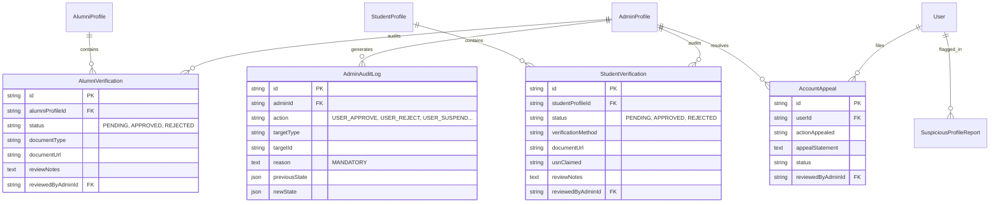
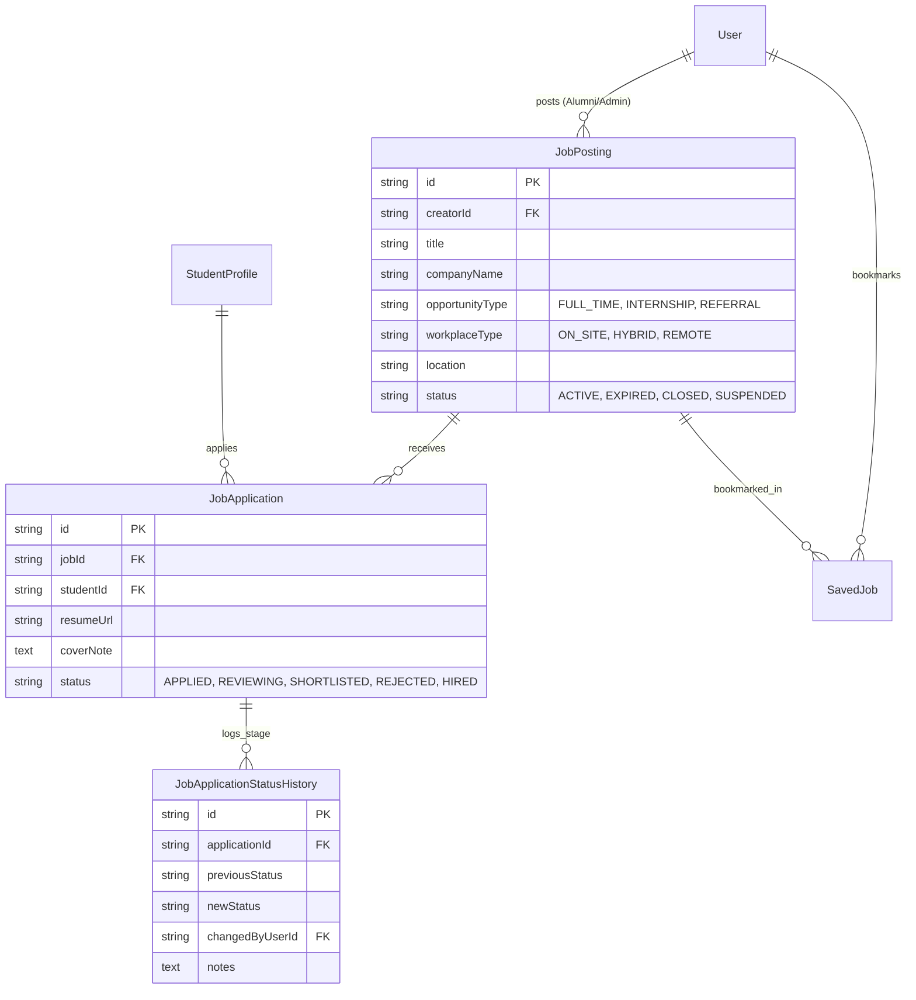

# Alumni Connect — Complete Relational ER Diagram

**Project:** Alumni Connect  
**Database Engine:** MySQL 8 (InnoDB Engine)  
**ORM Framework:** Prisma 6  
**Document Version:** 2.0 (Phase 2 Database Design)  
**Status:** Design Proposal (Awaiting Approval)  

---

## 1. Visual Legend & Entity Classification

To clearly distinguish between the existing database foundation and proposed additions, entities are categorized as follows:

| Tag | Category | Description | Count |
| :---: | :--- | :--- | :---: |
| **`[EXISTING]`** | Existing Foundation | Table verified in MySQL 8 via migration `20261109025514_init_schema`. Reused with non-breaking field additions. | 8 tables (+ migrations) |
| **`[PROPOSED]`** | Proposed Additions | New relational entities designed to support complete functional specifications. | 23 tables |

---

## 2. Master Entity-Relationship Diagram

```mermaid
erDiagram
    %% =========================================================================
    %% MODULE A: USER MANAGEMENT & PROFILES (EXISTING FOUNDATION)
    %% =========================================================================
    User ||--o| StudentProfile : "has [EXISTING]"
    User ||--o| AlumniProfile : "has [EXISTING]"
    User ||--o| AdminProfile : "has [EXISTING]"
    User ||--o{ LinkedAccount : "links [EXISTING]"
    User ||--o{ UserSkill : "possesses [EXISTING]"
    Skill ||--o{ UserSkill : "categorizes [EXISTING]"

    User {
        string id PK "cuid [EXISTING]"
        string email UK "[EXISTING]"
        string passwordHash "[EXISTING]"
        enum role "STUDENT, ALUMNI, ADMIN [EXISTING]"
        enum status "PENDING_VERIF, VERIFIED, REJECTED, SUSPENDED [PROPOSED]"
        boolean isEmailVerified "[EXISTING]"
        boolean isActive "[EXISTING]"
        string avatarUrl "[EXISTING]"
        datetime createdAt "[EXISTING]"
        datetime updatedAt "[EXISTING]"
    }

    StudentProfile {
        string id PK "cuid [EXISTING]"
        string userId FK "[EXISTING]"
        string rollNumber UK "[EXISTING]"
        string department "[EXISTING]"
        string degree "[EXISTING]"
        int expectedGraduationYear "[EXISTING]"
        int currentSemester "[EXISTING]"
        float cgpa "[EXISTING]"
        string resumeUrl "[EXISTING]"
        boolean isVerified "[PROPOSED]"
        datetime createdAt "[EXISTING]"
        datetime updatedAt "[EXISTING]"
    }

    AlumniProfile {
        string id PK "cuid [EXISTING]"
        string userId FK "[EXISTING]"
        int graduationYear "[EXISTING]"
        string degree "[EXISTING]"
        string department "[EXISTING]"
        string currentCompany "[EXISTING]"
        string currentDesignation "[EXISTING]"
        boolean isWillingToMentor "[EXISTING]"
        int maxMentees "[PROPOSED]"
        boolean isVerified "[EXISTING]"
        datetime createdAt "[EXISTING]"
        datetime updatedAt "[EXISTING]"
    }

    AdminProfile {
        string id PK "cuid [EXISTING]"
        string userId FK "[EXISTING]"
        string employeeId UK "[EXISTING]"
        string department "[EXISTING]"
        string designation "[EXISTING]"
        string permissions "[EXISTING]"
        datetime createdAt "[EXISTING]"
        datetime updatedAt "[EXISTING]"
    }

    LinkedAccount {
        string id PK "cuid [EXISTING]"
        string userId FK "[EXISTING]"
        enum provider "LINKEDIN, GOOGLE, GITHUB [EXISTING]"
        string providerAccountId "[EXISTING]"
        text accessToken "[EXISTING]"
        datetime expiresAt "[EXISTING]"
    }

    Skill {
        string id PK "cuid [EXISTING]"
        string name UK "[EXISTING]"
        string slug UK "[EXISTING]"
        string category "[EXISTING]"
    }

    UserSkill {
        string id PK "cuid [EXISTING]"
        string userId FK "[EXISTING]"
        string skillId FK "[EXISTING]"
        enum proficiency "[EXISTING]"
    }

    %% =========================================================================
    %% MODULE B & C: VERIFICATION, AUDITING & TRUST DESK
    %% =========================================================================
    AlumniProfile ||--o{ AlumniVerification : "submits [EXISTING]"
    AdminProfile ||--o{ AlumniVerification : "reviews [EXISTING]"
    StudentProfile ||--o{ StudentVerification : "submits [PROPOSED]"
    AdminProfile ||--o{ StudentVerification : "reviews [PROPOSED]"
    AdminProfile ||--o{ AdminAuditLog : "executes [PROPOSED]"
    User ||--o{ SuspiciousProfileReport : "flagged [PROPOSED]"
    User ||--o{ UserReport : "reports_or_reported [PROPOSED]"
    User ||--o{ AccountAppeal : "submits [PROPOSED]"

    AlumniVerification {
        string id PK "[EXISTING]"
        string alumniProfileId FK "[EXISTING]"
        enum status "PENDING, APPROVED, REJECTED [EXISTING]"
        string documentType "[EXISTING]"
        string documentUrl "[EXISTING]"
        text reviewNotes "[EXISTING]"
        string reviewedByAdminId FK "[EXISTING]"
        datetime reviewedAt "[EXISTING]"
    }

    StudentVerification {
        string id PK "[PROPOSED]"
        string studentProfileId FK "[PROPOSED]"
        enum status "PENDING, APPROVED, REJECTED [PROPOSED]"
        string verificationMethod "[PROPOSED]"
        string documentUrl "[PROPOSED]"
        string usnClaimed "[PROPOSED]"
        text reviewNotes "[PROPOSED]"
        string reviewedByAdminId FK "[PROPOSED]"
        datetime reviewedAt "[PROPOSED]"
    }

    AdminAuditLog {
        string id PK "[PROPOSED]"
        string adminId FK "[PROPOSED]"
        enum action "[PROPOSED]"
        string targetType "[PROPOSED]"
        string targetId "[PROPOSED]"
        text reason "[PROPOSED]"
        json previousState "[PROPOSED]"
        json newState "[PROPOSED]"
        datetime createdAt "[PROPOSED]"
    }

    SuspiciousProfileReport {
        string id PK "[PROPOSED]"
        string userId FK "[PROPOSED]"
        int suspicionScore "[PROPOSED]"
        string anomalyFlags "[PROPOSED]"
        enum status "[PROPOSED]"
        string investigatedByAdminId FK "[PROPOSED]"
    }

    UserReport {
        string id PK "[PROPOSED]"
        string reporterId FK "[PROPOSED]"
        string reportedUserId FK "[PROPOSED]"
        enum category "[PROPOSED]"
        text description "[PROPOSED]"
        enum status "[PROPOSED]"
        string resolvedByAdminId FK "[PROPOSED]"
    }

    AccountAppeal {
        string id PK "[PROPOSED]"
        string userId FK "[PROPOSED]"
        enum actionAppealed "[PROPOSED]"
        text appealStatement "[PROPOSED]"
        enum status "[PROPOSED]"
        string reviewedByAdminId FK "[PROPOSED]"
    }

    %% =========================================================================
    %% MODULE D: MENTORSHIP WORKFLOW (PROPOSED)
    %% =========================================================================
    StudentProfile ||--o{ MentorshipRequest : "initiates [PROPOSED]"
    AlumniProfile ||--o{ MentorshipRequest : "receives [PROPOSED]"
    MentorshipRequest ||--o| MentorshipSession : "confirms_as [PROPOSED]"

    MentorshipRequest {
        string id PK "[PROPOSED]"
        string studentId FK "[PROPOSED]"
        string alumniId FK "[PROPOSED]"
        string topic "[PROPOSED]"
        text reason "[PROPOSED]"
        enum status "PENDING, ACCEPTED, DECLINED, COMPLETED [PROPOSED]"
        datetime createdAt "[PROPOSED]"
    }

    MentorshipSession {
        string id PK "[PROPOSED]"
        string requestId FK UK "[PROPOSED]"
        datetime scheduledAt "[PROPOSED]"
        int durationMinutes "[PROPOSED]"
        enum meetingType "[PROPOSED]"
        string meetingUrl "[PROPOSED]"
        enum status "[PROPOSED]"
    }

    %% =========================================================================
    %% MODULE E: MESSAGING & GATING (PROPOSED)
    %% =========================================================================
    User ||--o{ MessageRequest : "sender_or_receiver [PROPOSED]"
    Conversation ||--o{ ConversationParticipant : "has [PROPOSED]"
    User ||--o{ ConversationParticipant : "joins [PROPOSED]"
    Conversation ||--o{ DirectMessage : "contains [PROPOSED]"
    User ||--o{ DirectMessage : "authors [PROPOSED]"
    User ||--o{ UserBlock : "blocks_or_blocked [PROPOSED]"

    MessageRequest {
        string id PK "[PROPOSED]"
        string senderId FK "[PROPOSED]"
        string receiverId FK "[PROPOSED]"
        string introduction "[PROPOSED]"
        enum status "PENDING, ACCEPTED, DECLINED [PROPOSED]"
    }

    Conversation {
        string id PK "[PROPOSED]"
        enum type "[PROPOSED]"
        datetime lastMessageAt "[PROPOSED]"
    }

    ConversationParticipant {
        string id PK "[PROPOSED]"
        string conversationId FK "[PROPOSED]"
        string userId FK "[PROPOSED]"
        datetime lastReadAt "[PROPOSED]"
    }

    DirectMessage {
        string id PK "[PROPOSED]"
        string conversationId FK "[PROPOSED]"
        string senderId FK "[PROPOSED]"
        text content "[PROPOSED]"
        boolean isRead "[PROPOSED]"
        datetime createdAt "[PROPOSED]"
    }

    UserBlock {
        string id PK "[PROPOSED]"
        string blockerId FK "[PROPOSED]"
        string blockedUserId FK "[PROPOSED]"
        string reason "[PROPOSED]"
    }

    %% =========================================================================
    %% MODULE F: JOBS & INTERNSHIPS (PROPOSED)
    %% =========================================================================
    User ||--o{ JobPosting : "publishes [PROPOSED]"
    JobPosting ||--o{ JobApplication : "receives [PROPOSED]"
    StudentProfile ||--o{ JobApplication : "submits [PROPOSED]"
    JobApplication ||--o{ JobApplicationStatusHistory : "tracks [PROPOSED]"
    User ||--o{ SavedJob : "bookmarks [PROPOSED]"
    JobPosting ||--o{ SavedJob : "saved_by [PROPOSED]"

    JobPosting {
        string id PK "[PROPOSED]"
        string creatorId FK "[PROPOSED]"
        string title "[PROPOSED]"
        string companyName "[PROPOSED]"
        enum opportunityType "[PROPOSED]"
        enum workplaceType "[PROPOSED]"
        string location "[PROPOSED]"
        enum status "ACTIVE, EXPIRED, CLOSED, SUSPENDED [PROPOSED]"
    }

    JobApplication {
        string id PK "[PROPOSED]"
        string jobId FK "[PROPOSED]"
        string studentId FK "[PROPOSED]"
        string resumeUrl "[PROPOSED]"
        enum status "APPLIED, REVIEWING, SHORTLISTED, REJECTED, HIRED [PROPOSED]"
    }

    JobApplicationStatusHistory {
        string id PK "[PROPOSED]"
        string applicationId FK "[PROPOSED]"
        enum previousStatus "[PROPOSED]"
        enum newStatus "[PROPOSED]"
        string changedByUserId FK "[PROPOSED]"
    }

    SavedJob {
        string id PK "[PROPOSED]"
        string userId FK "[PROPOSED]"
        string jobId FK "[PROPOSED]"
    }

    %% =========================================================================
    %% MODULE G, H, I, J: EVENTS, ANNOUNCEMENTS, FORUMS & NOTIFICATIONS (PROPOSED)
    %% =========================================================================
    AdminProfile ||--o{ CampusEvent : "authors [PROPOSED]"
    CampusEvent ||--o{ EventRegistration : "enrolled_by [PROPOSED]"
    User ||--o{ EventRegistration : "registers [PROPOSED]"
    AdminProfile ||--o{ Announcement : "broadcasts [PROPOSED]"
    User ||--o{ DiscussionPost : "creates [PROPOSED]"
    DiscussionPost ||--o{ DiscussionComment : "has [PROPOSED]"
    User ||--o{ DiscussionComment : "authors [PROPOSED]"
    DiscussionPost ||--o{ PostLike : "upvoted_by [PROPOSED]"
    User ||--o{ PostLike : "likes [PROPOSED]"
    DiscussionPost ||--o{ PostReport : "reported_by [PROPOSED]"
    User ||--o{ Notification : "receives [PROPOSED]"

    CampusEvent {
        string id PK "[PROPOSED]"
        string authorAdminId FK "[PROPOSED]"
        string title "[PROPOSED]"
        enum category "[PROPOSED]"
        datetime startTime "[PROPOSED]"
        datetime endTime "[PROPOSED]"
        string venue "[PROPOSED]"
        enum status "[PROPOSED]"
    }

    EventRegistration {
        string id PK "[PROPOSED]"
        string eventId FK "[PROPOSED]"
        string userId FK "[PROPOSED]"
        enum attendanceStatus "[PROPOSED]"
        int feedbackRating "[PROPOSED]"
    }

    Announcement {
        string id PK "[PROPOSED]"
        string authorAdminId FK "[PROPOSED]"
        string title "[PROPOSED]"
        enum category "[PROPOSED]"
        enum targetAudience "[PROPOSED]"
        enum priority "[PROPOSED]"
        enum status "[PROPOSED]"
    }

    DiscussionPost {
        string id PK "[PROPOSED]"
        string authorId FK "[PROPOSED]"
        enum channel "[PROPOSED]"
        string title "[PROPOSED]"
        int upvoteCount "[PROPOSED]"
        enum status "[PROPOSED]"
    }

    DiscussionComment {
        string id PK "[PROPOSED]"
        string postId FK "[PROPOSED]"
        string authorId FK "[PROPOSED]"
        text content "[PROPOSED]"
    }

    PostLike {
        string id PK "[PROPOSED]"
        string postId FK "[PROPOSED]"
        string userId FK "[PROPOSED]"
    }

    PostReport {
        string id PK "[PROPOSED]"
        string postId FK "[PROPOSED]"
        string reporterId FK "[PROPOSED]"
        enum reason "[PROPOSED]"
    }

    Notification {
        string id PK "[PROPOSED]"
        string userId FK "[PROPOSED]"
        enum type "[PROPOSED]"
        string title "[PROPOSED]"
        string message "[PROPOSED]"
        boolean isRead "[PROPOSED]"
        datetime createdAt "[PROPOSED]"
    }
```

---

## 3. Subsystem Domain Breakdowns

### 3.1. Verification & Administrative Governance Subsystem



---

### 3.2. Mentorship & Messaging Subsystem

```mermaid
erDiagram
    StudentProfile ||--o{ MentorshipRequest : "submits_reason"
    AlumniProfile ||--o{ MentorshipRequest : "reviews_voluntarily"
    MentorshipRequest ||--o| MentorshipSession : "confirmed_meeting"

    User ||--o{ MessageRequest : "sends"
    User ||--o{ MessageRequest : "receives"
    Conversation ||--o{ ConversationParticipant : "members"
    User ||--o{ ConversationParticipant : "enrolled"
    Conversation ||--o{ DirectMessage : "has"
    User ||--o{ DirectMessage : "sends"

    MentorshipRequest {
        string id PK
        string studentId FK
        string alumniId FK
        string topic
        text reason "MANDATORY 100-500 words"
        string status "PENDING, ACCEPTED, DECLINED, COMPLETED"
    }

    MentorshipSession {
        string id PK
        string requestId FK UK
        datetime scheduledAt
        int durationMinutes
        string meetingType
        string meetingUrl
        string status
    }

    MessageRequest {
        string id PK
        string senderId FK
        string receiverId FK
        string introduction "max 500 chars"
        string status "PENDING, ACCEPTED, DECLINED"
    }

    DirectMessage {
        string id PK
        string conversationId FK
        string senderId FK
        text content
        boolean isRead
        datetime createdAt
    }
```

---

### 3.3. Career Hub: Jobs, Internships & Applications



---

## 4. Entity Attribute Reference Table

| Entity Name | Primary Key | Foreign Keys | Unique Constraints | Indexed Fields |
| :--- | :--- | :--- | :--- | :--- |
| **`User`** `[EXISTING]` | `id` | None | `email` | `role`, `status`, `email` |
| **`StudentProfile`** `[EXISTING]` | `id` | `userId` $\rightarrow$ `User` | `userId`, `rollNumber` | `department`, `expectedGraduationYear`, `isVerified` |
| **`AlumniProfile`** `[EXISTING]` | `id` | `userId` $\rightarrow$ `User` | `userId` | `graduationYear`, `currentCompany`, `industry`, `isVerified`, `isWillingToMentor` |
| **`AdminProfile`** `[EXISTING]` | `id` | `userId` $\rightarrow$ `User` | `userId`, `employeeId` | `department` |
| **`LinkedAccount`** `[EXISTING]`| `id` | `userId` $\rightarrow$ `User` | `(provider, providerAccountId)` | `userId` |
| **`AlumniVerification`** `[EXISTING]`| `id` | `alumniProfileId` $\rightarrow$ `AlumniProfile`, `reviewedByAdminId` $\rightarrow$ `AdminProfile` | None | `alumniProfileId`, `status`, `reviewedByAdminId` |
| **`Skill`** `[EXISTING]` | `id` | None | `name`, `slug` | `category` |
| **`UserSkill`** `[EXISTING]` | `id` | `userId` $\rightarrow$ `User`, `skillId` $\rightarrow$ `Skill` | `(userId, skillId)` | `userId`, `skillId` |
| **`StudentVerification`** `[PROPOSED]`| `id` | `studentProfileId` $\rightarrow$ `StudentProfile`, `reviewedByAdminId` $\rightarrow$ `AdminProfile`| None | `studentProfileId`, `status`, `reviewedByAdminId` |
| **`AdminAuditLog`** `[PROPOSED]`| `id` | `adminId` $\rightarrow$ `AdminProfile` | None | `adminId`, `action`, `targetType`, `targetId`, `createdAt` |
| **`SuspiciousProfileReport`** `[PROPOSED]`| `id` | `userId` $\rightarrow$ `User`, `investigatedByAdminId` $\rightarrow$ `AdminProfile`| None | `userId`, `status`, `investigatedByAdminId` |
| **`UserReport`** `[PROPOSED]` | `id` | `reporterId` $\rightarrow$ `User`, `reportedUserId` $\rightarrow$ `User`, `resolvedByAdminId` $\rightarrow$ `AdminProfile` | None | `reporterId`, `reportedUserId`, `category`, `status` |
| **`AccountAppeal`** `[PROPOSED]`| `id` | `userId` $\rightarrow$ `User`, `reviewedByAdminId` $\rightarrow$ `AdminProfile` | None | `userId`, `actionAppealed`, `status` |
| **`MentorshipRequest`** `[PROPOSED]`| `id` | `studentId` $\rightarrow$ `StudentProfile`, `alumniId` $\rightarrow$ `AlumniProfile` | None | `studentId`, `alumniId`, `status` |
| **`MentorshipSession`** `[PROPOSED]`| `id` | `requestId` $\rightarrow$ `MentorshipRequest` | `requestId` | `scheduledAt`, `status` |
| **`MessageRequest`** `[PROPOSED]`| `id` | `senderId` $\rightarrow$ `User`, `receiverId` $\rightarrow$ `User` | `(senderId, receiverId)` | `status` |
| **`Conversation`** `[PROPOSED]` | `id` | None | None | `lastMessageAt` |
| **`ConversationParticipant`** `[PROPOSED]`| `id` | `conversationId` $\rightarrow$ `Conversation`, `userId` $\rightarrow$ `User` | `(conversationId, userId)` | `conversationId`, `userId` |
| **`DirectMessage`** `[PROPOSED]`| `id` | `conversationId` $\rightarrow$ `Conversation`, `senderId` $\rightarrow$ `User` | None | `conversationId`, `senderId`, `isRead`, `createdAt` |
| **`UserBlock`** `[PROPOSED]` | `id` | `blockerId` $\rightarrow$ `User`, `blockedUserId` $\rightarrow$ `User` | `(blockerId, blockedUserId)` | `blockerId`, `blockedUserId` |
| **`JobPosting`** `[PROPOSED]` | `id` | `creatorId` $\rightarrow$ `User`, `moderatedByAdminId` $\rightarrow$ `AdminProfile` | None | `creatorId`, `companyName`, `opportunityType`, `workplaceType`, `status`, `applicationDeadline` |
| **`JobApplication`** `[PROPOSED]`| `id` | `jobId` $\rightarrow$ `JobPosting`, `studentId` $\rightarrow$ `StudentProfile` | `(jobId, studentId)` | `jobId`, `studentId`, `status` |
| **`JobApplicationStatusHistory`** `[PROPOSED]`| `id`| `applicationId` $\rightarrow$ `JobApplication`, `changedByUserId` $\rightarrow$ `User` | None | `applicationId`, `createdAt` |
| **`SavedJob`** `[PROPOSED]` | `id` | `userId` $\rightarrow$ `User`, `jobId` $\rightarrow$ `JobPosting` | `(userId, jobId)` | `userId`, `jobId` |
| **`CampusEvent`** `[PROPOSED]` | `id` | `authorAdminId` $\rightarrow$ `AdminProfile` | None | `authorAdminId`, `category`, `startTime`, `status` |
| **`EventRegistration`** `[PROPOSED]`| `id` | `eventId` $\rightarrow$ `CampusEvent`, `userId` $\rightarrow$ `User` | `(eventId, userId)` | `eventId`, `userId`, `attendanceStatus` |
| **`Announcement`** `[PROPOSED]`| `id` | `authorAdminId` $\rightarrow$ `AdminProfile` | None | `authorAdminId`, `category`, `targetAudience`, `priority`, `status`, `publishedAt` |
| **`DiscussionPost`** `[PROPOSED]`| `id` | `authorId` $\rightarrow$ `User` | None | `authorId`, `channel`, `upvoteCount`, `status` |
| **`DiscussionComment`** `[PROPOSED]`| `id` | `postId` $\rightarrow$ `DiscussionPost`, `authorId` $\rightarrow$ `User` | None | `postId`, `authorId`, `status` |
| **`PostLike`** `[PROPOSED]` | `id` | `postId` $\rightarrow$ `DiscussionPost`, `userId` $\rightarrow$ `User` | `(postId, userId)` | `postId`, `userId` |
| **`PostReport`** `[PROPOSED]` | `id` | `postId` $\rightarrow$ `DiscussionPost`, `reporterId` $\rightarrow$ `User`, `reviewedByAdminId` $\rightarrow$ `AdminProfile` | None | `postId`, `reporterId`, `reason`, `status` |
| **`Notification`** `[PROPOSED]`| `id` | `userId` $\rightarrow$ `User` | None | `userId`, `type`, `isRead`, `createdAt` |
