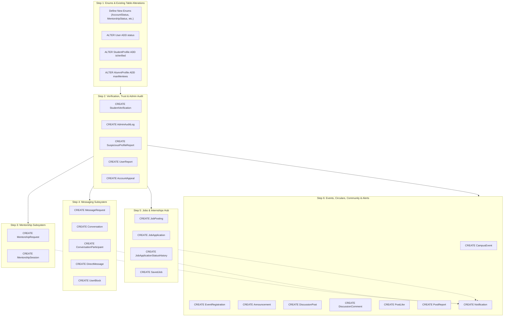

# Alumni Connect — Relational Database Migration & Safe Extension Plan

**Project:** Alumni Connect  
**Database Engine:** MySQL 8 (InnoDB Engine)  
**ORM Framework:** Prisma 6  
**Document Version:** 2.0 (Phase 2 Database Design)  
**Status:** Migration Architecture Plan (Awaiting Approval)  

---

## 1. Migration Strategy & Zero Data-Loss Principles

The Alumni Connect platform already possesses a functioning MySQL 8 database (`alumni_connect`) with initial migration `20261109025514_init_schema` applied, nine tables active, and active demo records seeded.

### Strict Engineering Principles for Extension
1. **Never Rebuild from Scratch:** Under no circumstance should `npx prisma migrate reset` or table drops be executed. All existing data in `User`, `StudentProfile`, `AlumniProfile`, `AdminProfile`, `Skill`, `UserSkill`, `LinkedAccount`, and `AlumniVerification` must be preserved.
2. **Backward-Compatible Schema Evolution:** All new columns added to existing tables must either be `NULL` or have a safe `@default(...)` so existing rows remain valid without requiring manual data patching.
3. **Strict Dependency Sequencing:** Foreign keys must be created in topological order (parent tables before child tables).
4. **Isolated Migration Batches:** New modules can be applied incrementally in logical groups (Verification Desk $\rightarrow$ Mentorship $\rightarrow$ Messaging $\rightarrow$ Jobs $\rightarrow$ Events $\rightarrow$ Community & Notifications).
5. **No Schema Changes Without Prior Approval:** In accordance with Phase 2 rules, no SQL scripts or `schema.prisma` edits are executed until the design and migration plan are explicitly approved by the product owner.

---

## 2. Table Inventory: Reused, Extended & Proposed

```
Current Database State (9 Tables):
├── User [REUSED & EXTENDED]
├── StudentProfile [REUSED & EXTENDED]
├── AlumniProfile [REUSED & EXTENDED]
├── AdminProfile [REUSED]
├── LinkedAccount [REUSED]
├── AlumniVerification [REUSED]
├── Skill [REUSED]
├── UserSkill [REUSED]
└── _prisma_migrations [SYSTEM TABLE]

Target Database State (32 Application Tables):
├── Module A: Identity & Profiles (6 tables)
├── Module B & C: Verification, Auditing & Trust (6 tables)
├── Module D: Mentorship Workflow (2 tables)
├── Module E: Gated Messaging & Chats (5 tables)
├── Module F: Jobs & Internships Hub (4 tables)
├── Module G: Campus Events & Meets (2 tables)
├── Module H: College Announcements (1 table)
├── Module I: Community Forums & Moderation (4 tables)
└── Module J: In-App Notifications (1 table)
```

### Detailed Breakdown

| Table Name | Action | Change Details |
| :--- | :---: | :--- |
| **`User`** | **REUSE & EXTEND** | Add `status ENUM('PENDING_VERIFICATION', 'VERIFIED', 'REJECTED', 'SUSPENDED') DEFAULT 'PENDING_VERIFICATION'`. Add index on `status`. Existing data is backfilled to `'VERIFIED'` for seeded accounts. |
| **`StudentProfile`** | **REUSE & EXTEND** | Add `isVerified BOOLEAN DEFAULT false`. Add index on `isVerified`. |
| **`AlumniProfile`** | **REUSE & EXTEND** | Add `maxMentees INT DEFAULT 2` (voluntary capacity quota). |
| **`AdminProfile`** | **REUSE** | Kept intact. Acts as parent for audit logs, verifications, and circulars. |
| **`LinkedAccount`** | **REUSE** | Kept intact. Social auth and LinkedIn OIDC claims preserved. |
| **`AlumniVerification`** | **REUSE** | Kept intact. Preserves existing verification records and reviewer links. |
| **`Skill`** | **REUSE** | Kept intact. Preserves seeded technical taxonomy. |
| **`UserSkill`** | **REUSE** | Kept intact. Preserves student and alumni skill endorsements. |
| **`StudentVerification`** | **PROPOSED NEW** | Student verification audit queue and registrar matching. |
| **`AdminAuditLog`** | **PROPOSED NEW** | Immutable audit log of administrative decisions (approvals, suspensions). |
| **`SuspiciousProfileReport`**| **PROPOSED NEW** | Assistive scoring for anomaly detection (no automated bans). |
| **`UserReport`** | **PROPOSED NEW** | Member reporting for harassment, spam, and fake profiles. |
| **`AccountAppeal`** | **PROPOSED NEW** | Formal reconsideration workflow for suspended or rejected users. |
| **`MentorshipRequest`** | **PROPOSED NEW** | Structured mentorship requests with mandatory topic and reason. |
| **`MentorshipSession`** | **PROPOSED NEW** | Confirmed 1-on-1 meetings created only upon alumni acceptance. |
| **`MessageRequest`** | **PROPOSED NEW** | Inbound message request holding pen protecting alumni from spam. |
| **`Conversation`** | **PROPOSED NEW** | Unlocked messaging threads. |
| **`ConversationParticipant`**| **PROPOSED NEW** | Associative membership join table. |
| **`DirectMessage`** | **PROPOSED NEW** | Messages within active conversations. |
| **`UserBlock`** | **PROPOSED NEW** | Mutual blocking of unwanted contacts. |
| **`JobPosting`** | **PROPOSED NEW** | Voluntary job and internship postings from Alumni and CDC Admin. |
| **`JobApplication`** | **PROPOSED NEW** | Student job applications with resume links. |
| **`JobApplicationStatusHistory`**| **PROPOSED NEW**| Audit trail of application stage progression. |
| **`SavedJob`** | **PROPOSED NEW** | Student job bookmarks. |
| **`CampusEvent`** | **PROPOSED NEW** | Admin-created webinars, alumni meets, and workshops. |
| **`EventRegistration`** | **PROPOSED NEW** | Event bookings and attendance check-ins. |
| **`Announcement`** | **PROPOSED NEW** | Official college broadcasts, placement updates, and circulars. |
| **`DiscussionPost`** | **PROPOSED NEW** | Forum discussion threads across campus channels. |
| **`DiscussionComment`** | **PROPOSED NEW** | Forum post replies. |
| **`PostLike`** | **PROPOSED NEW** | Deduplicated upvotes on forum posts. |
| **`PostReport`** | **PROPOSED NEW** | Moderation queue flags for forum posts. |
| **`Notification`** | **PROPOSED NEW** | In-app alerts linked to domain entities. |

---

## 3. Dependency Graph & Step-by-Step Migration Sequencing



### Detailed Execution Sequence

#### Step 1: Enum Additions & Existing Table Alterations
- Register new MySQL ENUM types in Prisma schema.
- Add non-breaking columns with default values:
  - `User.status`: default `'PENDING_VERIFICATION'`
  - `StudentProfile.isVerified`: default `false`
  - `AlumniProfile.maxMentees`: default `2`
- Run data patch:
  ```sql
  -- Backfill pre-existing verified test accounts
  UPDATE `User` SET `status` = 'VERIFIED' WHERE `email` IN ('admin@alumniconnect.edu', 'sarah.chen@alumni.edu');
  UPDATE `User` SET `status` = 'VERIFIED' WHERE `email` = 'alex.rivera@student.edu';
  UPDATE `StudentProfile` SET `isVerified` = true WHERE `userId` IN (SELECT `id` FROM `User` WHERE `email` = 'alex.rivera@student.edu');
  ```

#### Step 2: Verification, Trust Desk & Audit Logs
- Create `StudentVerification` (depends on `StudentProfile`, `AdminProfile`).
- Create `AdminAuditLog` (depends on `AdminProfile`). **Constraint:** Enforce `ON DELETE RESTRICT` on `adminId`.
- Create `SuspiciousProfileReport`, `UserReport`, `AccountAppeal` (depend on `User`, `AdminProfile`).

#### Step 3: Mentorship Subsystem
- Create `MentorshipRequest` (depends on `StudentProfile`, `AlumniProfile`).
- Create `MentorshipSession` (depends on `MentorshipRequest`).

#### Step 4: Gated Messaging Subsystem
- Create `MessageRequest` (depends on `User`).
- Create `Conversation` (independent root entity).
- Create `ConversationParticipant` (depends on `Conversation`, `User`).
- Create `DirectMessage` (depends on `Conversation`, `User`).
- Create `UserBlock` (depends on `User`).

#### Step 5: Jobs & Internships Hub
- Create `JobPosting` (depends on `User`, `AdminProfile`).
- Create `JobApplication` (depends on `JobPosting`, `StudentProfile`).
- Create `JobApplicationStatusHistory` (depends on `JobApplication`, `User`).
- Create `SavedJob` (depends on `User`, `JobPosting`).

#### Step 6: Events, Circulars, Community & Notifications
- Create `CampusEvent` (depends on `AdminProfile`).
- Create `EventRegistration` (depends on `CampusEvent`, `User`).
- Create `Announcement` (depends on `AdminProfile`).
- Create `DiscussionPost` (depends on `User`).
- Create `DiscussionComment` (depends on `DiscussionPost`, `User`).
- Create `PostLike` (depends on `DiscussionPost`, `User`).
- Create `PostReport` (depends on `DiscussionPost`, `User`, `AdminProfile`).
- Create `Notification` (depends on `User`).

---

## 4. Risk Assessment & Mitigation Matrix

| Risk Scenario | Severity | Impact | Mitigation Strategy |
| :--- | :---: | :--- | :--- |
| **Accidental Table Reset** | High | Loss of existing users, skills, and seed data. | **NEVER** run `prisma migrate reset` in development or production. Always generate forward migrations with `prisma migrate dev --name <migration_name>`. |
| **Lock Contention on `User` Table** | Medium | Brief latency spike during `ALTER TABLE User ADD COLUMN status`. | In MySQL 8, adding a column with a default value uses `ALGORITHM=INSTANT`, which avoids table copy and completes in milliseconds without blocking reads. |
| **Broken Foreign Key References on Admin Deletion** | High | Deleting an admin account could orphan audit logs or circulars. | Use `ON DELETE RESTRICT` on `AdminAuditLog.adminId` and `Announcement.authorAdminId`. Admins cannot be deleted; they can only be marked inactive. |
| **Duplicate Mentorship Spam** | Medium | A student spamming multiple identical requests to the same alumnus. | Enforce database-level composite unique constraint or unique index on active pending requests: `(studentId, alumniId, status)`. |
| **Orphaned Direct Messages** | Low | Deleting a user leaves hanging chat records. | `ConversationParticipant` and `DirectMessage` enforce `ON DELETE CASCADE`. If a user deletes their account, their participant record is removed while chat context remains coherent. |
| **Data Length Truncation** | Low | Document URLs or LinkedIn profile URLs exceeding `VARCHAR(191)`. | Use `VARCHAR(255)` or `VARCHAR(512)` for URLs, and `TEXT` for bios, reasons, and descriptions. |

---

## 5. Verification & Rollback Procedures

### Pre-Migration Verification Checklist
1. Export a full MySQL dump of `alumni_connect` database:
   ```bash
   mysqldump -u root -p alumni_connect > backup_pre_phase2.sql
   ```
2. Confirm the 9 initial tables and row counts:
   - `User`, `StudentProfile`, `AlumniProfile`, `AdminProfile`, `Skill`, `UserSkill`, `LinkedAccount`, `AlumniVerification`, `_prisma_migrations`.

### Post-Migration Verification Checklist
1. Verify all 32 application tables exist in `information_schema.tables`.
2. Verify foreign key integrity across parent-child links.
3. Verify that existing seed accounts (`admin@alumniconnect.edu`, `sarah.chen@alumni.edu`, `alex.rivera@student.edu`) retain their profile associations and can log in without errors.
4. Verify `/api/health` returns `status: "ok"` with `database.status: "up"`.

### Rollback Strategy
If any migration step fails:
1. Prisma migrations execute inside transactional DDL blocks where supported by MySQL 8.
2. If an intermediate migration requires rollback, restore from `backup_pre_phase2.sql`.
3. Existing application code remains unaffected since no breaking modifications to existing table column names or types are introduced.
