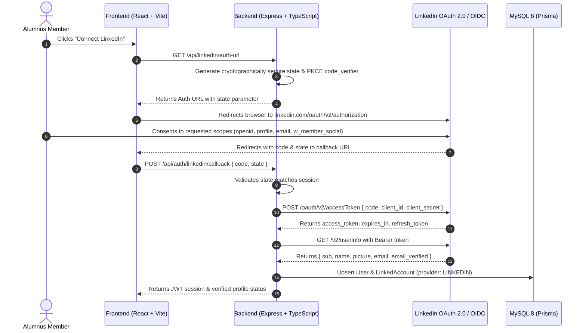

# LinkedIn Integration Architecture

## 1. Overview & Policy Compliance

Alumni Connect utilizes official **LinkedIn OAuth 2.0** and **OpenID Connect (OIDC)** standards to provide:
1. **1-Click Identity Assertion**: Verified sign-in and profile synchronization for graduating and senior alumni.
2. **Authorized Campus Referral Sharing**: Allows verified alumni to share campus job openings directly to their LinkedIn member network via official REST APIs.

> **Strict Compliance Policy**:  
> In accordance with LinkedIn Developer Platform Policies, Alumni Connect **never** engages in web scraping, headless session automation, or credential harvesting. All member data access is strictly gated through authorized OAuth 2.0 scopes approved by the user.

---

## 2. Supported Standard Scopes

| Scope | Category | Description in Alumni Connect |
| :--- | :--- | :--- |
| `openid` | OpenID Connect | Grants primary OpenID subject assertion (`sub`) confirming unique member identity. |
| `profile` | OpenID Connect | Retrieves certified member name (`name`, `given_name`, `family_name`) and profile picture. |
| `email` | OpenID Connect | Retrieves primary verified email address for account reconciliation. |
| `w_member_social` | Member Data API | Grants permission to author, publish, and delete authorized posts on behalf of the authenticated alumnus. |

---

## 3. Authorization Code Flow with PKCE & CSRF Defense



---

## 4. Database Persistence (`LinkedAccount` Model)

When a member connects their LinkedIn account, credentials and profile claims are stored securely in MySQL via the `LinkedAccount` model:

```prisma
model LinkedAccount {
  id                String          @id @default(cuid())
  userId            String
  user              User            @relation(fields: [userId], references: [id], onDelete: Cascade)
  provider          AccountProvider // LINKEDIN
  providerAccountId String          // LinkedIn 'sub' urn:li:person:...
  profileUrl        String?
  accessToken       String?         @db.Text
  refreshToken      String?         @db.Text
  expiresAt         DateTime?
  scope             String?         // "openid profile email w_member_social"
  rawProfile        String?         @db.Text
  createdAt         DateTime        @default(now())
  updatedAt         DateTime        @updatedAt

  @@unique([provider, providerAccountId])
  @@index([userId])
}
```

---

## 5. Authorized Content Sharing Protocol (`w_member_social`)

When an alumnus shares a verified job referral with college students, they can choose to amplify it on LinkedIn:

- **Endpoint**: `POST https://api.linkedin.com/rest/posts`
- **Headers**:
  ```http
  Authorization: Bearer <access_token>
  LinkedIn-Version: 202401
  X-Restli-Protocol-Version: 2.0.0
  Content-Type: application/json
  ```
- **Payload Schema**:
  ```json
  {
    "author": "urn:li:person:<sub_id>",
    "commentary": "Excited to mentor students from my alma mater! Open to reviewing resumes and referring qualified candidates for engineering roles on my team.",
    "visibility": "PUBLIC",
    "distribution": {
      "feedDistribution": "MAIN_FEED",
      "targetEntities": [],
      "thirdPartyDistributionChannels": []
    },
    "lifecycleState": "PUBLISHED"
  }
  ```

---

## 6. Local Setup & Credentials

To enable live LinkedIn OAuth testing:
1. Register a developer application at [LinkedIn Developer Portal](https://www.linkedin.com/developers/).
2. Add the **Sign In with LinkedIn using OpenID Connect** and **Share on LinkedIn** products.
3. Configure Authorized Redirect URL: `http://localhost:5000/api/auth/linkedin/callback`.
4. Copy Client ID and Client Secret into `server/.env`:
   ```env
   LINKEDIN_CLIENT_ID="your_client_id"
   LINKEDIN_CLIENT_SECRET="your_client_secret"
   LINKEDIN_REDIRECT_URI="http://localhost:5000/api/auth/linkedin/callback"
   ```
