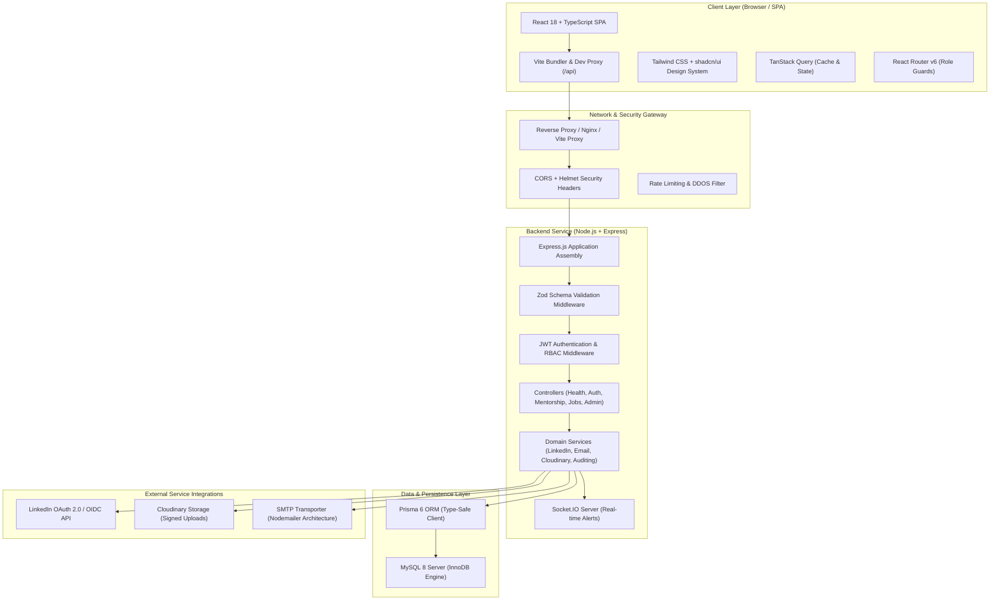
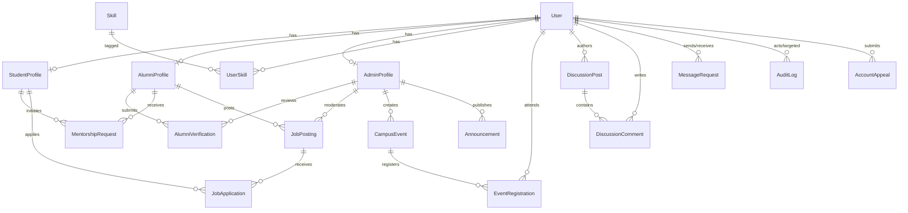

# Alumni Connect — System Architecture & Technical Specification

**Document Version:** 1.0  
**Classification:** Core System Architecture  
**Target Audience:** Engineering Team, System Architects, Technical Evaluators  
**Applies To:** Full-Stack Monorepo (`client`, `server`, `database`)  

---

## 1. High-Level System Architecture

Alumni Connect is designed as a decoupled, layered monorepo architecture leveraging modern web technologies, strict type safety, relational database integrity, and asynchronous service handlers.



---

## 2. Frontend Architecture (Client Workspace)

### 2.1. Technology Choices & Rationale
- **React 18 + Vite:** Fast Hot Module Replacement (HMR), tree-shaking, and predictable component lifecycles.
- **TypeScript (Strict Mode):** Prevents runtime `undefined` and type coercion defects; shares API payload interfaces with backend schemas.
- **Tailwind CSS:** Utility-first CSS allowing strict alignment with the institutional design tokens (Deep Navy, Slate, Professional Blue).
- **TanStack Query (React Query v5):** Robust asynchronous server-state caching, automatic background refetching (e.g., live health telemetry every 30 seconds), query invalidation, and optimistic UI updates.
- **React Router v6:** Declarative nested routing with layout shells and role-pathway segregation.
- **Lucide React:** Accessible, modern SVG icon set for navigation and system status.

### 2.2. Directory & Module Structure
```
client/src/
├── components/
│   ├── ui/               # Reusable primitive design system components
│   │   ├── Button.tsx    # Primary, Navy, Outline, Ghost, Danger variants
│   │   ├── Card.tsx      # Card, CardHeader, CardTitle, CardContent, CardFooter
│   │   ├── Badge.tsx     # Success, Warning, Blue, Navy status pills
│   │   └── Input.tsx     # Accessible text/email/password inputs with validation
│   ├── common/           # Shared application shell
│   │   ├── Navbar.tsx    # Global navigation, live MySQL telemetry pill, auth CTAs
│   │   └── Footer.tsx    # Institutional links, accreditation, system diagnostics
│   └── landing/          # Modular landing page sections
│       ├── HeroSection.tsx      # Main value proposition & role pathways
│       ├── StatsSection.tsx     # 4 impact counters (Alumni, Students, Employers)
│       ├── PillarsSection.tsx   # Tripartite value architecture breakdown
│       ├── PathwaysSection.tsx  # Role-specific interactive onboarding cards
│       ├── SpotlightSection.tsx # Featured verified alumni mentors
│       ├── LinkedInSection.tsx  # Compliant OpenID Connect sync preview
│       └── CTASection.tsx       # Final conversion call to action
├── pages/
│   ├── LandingPage.tsx   # Aggregated public marketing experience
│   ├── LoginPage.tsx     # Role tab switcher, quick-fill demo credentials, OIDC button
│   ├── RegisterPage.tsx  # Role-dependent form fields (USN vs. Batch & Company)
│   ├── dashboards/       # Segregated role workspaces
│   │   ├── StudentDashboard.tsx  # Mentorship requests, alumni recommendations
│   │   ├── AlumniDashboard.tsx   # Verification badge, voluntary mentor toggles
│   │   └── AdminDashboard.tsx    # Live telemetry, verification queue, audit table
│   └── NotFoundPage.tsx  # 404 error recovery
├── lib/
│   ├── api.ts            # Typed API client functions
│   └── utils.ts          # Tailwind merge helper (cn utility)
├── App.tsx               # BrowserRouter & QueryClientProvider setup
├── index.css             # Tailwind base styles, typography & focus rings
└── main.tsx              # React DOM root entry
```

### 2.3. Design System & Token Standards
- **Primary Color:** Deep Navy Blue (`#0F2744` / `navy-950`), symbolizing academic prestige, authority, and stability.
- **Interactive Accent:** Vibrant Royal Blue (`#2563EB` / `brand-600`), driving actionable calls to action.
- **Grounding Surfaces:** Cool Slate & Off-White (`#F8FAFC`, `#F1F5F9`), providing crisp separation for data tables and card layouts.
- **Typography:** High-legibility modern sans-serif (`Inter`, system-ui), with tabular figures for numbers, dates, and USN identifiers.

---

## 3. Backend Architecture (Server Workspace)

### 3.1. Layered Clean Architecture
The backend follows strict separation of concerns:

```
[ HTTP Ingress ] 
       │
       ▼
 [ Middleware ]  ──► (Helmet, CORS, Morgan, JSON Parser)
       │
       ▼
 [ Zod Schema ]  ──► (Strict Request Body & Query Validation)
       │
       ▼
[ Route Handler] ──► (Express Router Mapping)
       │
       ▼
 [ Controller ]  ──► (Extracts parameters, calls Service, wraps in ApiResponse)
       │
       ▼
  [ Service ]    ──► (Core business logic, security policies, transactions)
       │
       ▼
 [ Prisma ORM ]  ──► (Type-safe SQL query generation & connection pooling)
       │
       ▼
  [ MySQL 8 ]    ──► (InnoDB ACID Transactions & Relational Storage)
```

### 3.2. Centralized Error Handling Pipeline
All runtime exceptions are captured by a centralized error handling middleware (`server/src/middleware/errorHandler.ts`):
1. **`ZodError`**: Captured and transformed into structured field validation errors (`400 Bad Request`).
2. **`AppError`**: Custom operational errors (`BadRequestError`, `UnauthorizedError`, `ForbiddenError`, `NotFoundError`) mapped directly to appropriate HTTP status codes.
3. **Prisma Known Request Errors**:
   - `P2002`: Unique constraint violation mapped to `409 Conflict` (e.g., duplicate USN or email).
   - `P2025`: Record not found mapped to `404 Not Found`.
4. **Unhandled Server Errors**: Formatted as `500 Internal Server Error`, suppressing stack traces in production to prevent information disclosure.

### 3.3. Independent Observability & Health Monitoring
The platform implements an independent health check endpoint (`GET /api/health`):
```json
{
  "status": "ok",
  "service": "Alumni Connect API",
  "version": "1.0.0",
  "environment": "development",
  "timestamp": "2026-11-11T14:48:00.000Z",
  "services": {
    "backend": {
      "status": "up",
      "uptimeSeconds": 1420,
      "nodeVersion": "v24.22.0",
      "memory": {
        "rss": "42.15 MB",
        "heapTotal": "28.50 MB",
        "heapUsed": "18.32 MB"
      }
    },
    "database": {
      "dialect": "MySQL 8",
      "status": "up",
      "latencyMs": 4,
      "message": "Successfully connected to MySQL database via Prisma ORM"
    }
  }
}
```
If the MySQL server experiences latency spikes or connection interruptions, the API reports `status: "degraded"` and diagnostic details without crashing the Node.js process.

---

## 4. MySQL 8 & Prisma ORM Architecture

### 4.1. Strict MySQL Database Standard
As an absolute architectural constraint:
- **MySQL 8 (InnoDB engine)** is the sole application database.
- MongoDB, Mongoose, and other NoSQL document stores are strictly prohibited.
- All relationships enforce foreign key constraints, cascading rules, and relational integrity.

### 4.2. Existing Relational Schema Analysis
The current schema defines nine foundational tables:
1. `User`: Central authentication record with email, hashed password, role (`STUDENT`, `ALUMNI`, `ADMIN`), and account state flags.
2. `StudentProfile`: 1-to-1 extension storing USN/rollNumber, department, graduation year, CGPA, resumeUrl, and portfolio links.
3. `AlumniProfile`: 1-to-1 extension storing graduation year, degree, department, company, designation, experience, and mentorship availability.
4. `AdminProfile`: 1-to-1 extension storing institutional employeeId, department, designation, and granular permissions.
5. `LinkedAccount`: Stores OAuth 2.0 / OpenID Connect provider tokens (`LINKEDIN`, `GOOGLE`, `GITHUB`) with unique composite index `(provider, providerAccountId)`.
6. `AlumniVerification`: Audit-ready verification records tracking submitted document URLs, status (`PENDING`, `APPROVED`, `REJECTED`), submission notes, and reviewing administrator ID.
7. `Skill`: Curated taxonomy of technical and leadership skills with unique slug and category.
8. `UserSkill`: Associative many-to-many join table between `User` and `Skill` with proficiency rating (`BEGINNER`, `INTERMEDIATE`, `ADVANCED`, `EXPERT`) and endorsement counters.
9. `_prisma_migrations`: Prisma internal migration audit log ensuring schema synchronization across environments.

### 4.3. Schema Extensions for Complete Functional Scope
To support the full requirements for mentorship, jobs, events, forums, and messaging, the relational model is designed with the following normalized entities:



1. **`MentorshipRequest`**:
   - `id`: CUID Primary Key
   - `studentId`: Foreign Key -> `StudentProfile(id)` ON DELETE CASCADE
   - `alumniId`: Foreign Key -> `AlumniProfile(id)` ON DELETE CASCADE
   - `topic`: String (Mentorship topic)
   - `reason`: Text (Detailed justification for request)
   - `status`: Enum (`PENDING`, `ACCEPTED`, `DECLINED`, `COMPLETED`, `CANCELLED`)
   - `scheduledAt`: DateTime? (Confirmed session time)
   - `meetingUrl`: String? (Virtual meeting link)
   - `alumniNotes`: Text? (Optional message from alumnus on decision)
   - `createdAt`, `updatedAt`
2. **`JobPosting`**:
   - `id`: CUID Primary Key
   - `creatorId`: Foreign Key -> `User(id)` ON DELETE CASCADE
   - `title`: String
   - `company`: String
   - `jobType`: Enum (`FULL_TIME`, `INTERNSHIP`, `PART_TIME`, `REFERRAL`)
   - `location`: String (e.g., "Remote", "Bangalore", "San Francisco")
   - `department`: String? (Target academic branch)
   - `description`: Text
   - `applicationDeadline`: DateTime?
   - `status`: Enum (`ACTIVE`, `CLOSED`, `SUSPENDED`)
   - `createdAt`, `updatedAt`
3. **`JobApplication`**:
   - `id`: CUID Primary Key
   - `jobId`: Foreign Key -> `JobPosting(id)` ON DELETE CASCADE
   - `studentId`: Foreign Key -> `StudentProfile(id)` ON DELETE CASCADE
   - `resumeUrl`: String
   - `coverNote`: Text?
   - `status`: Enum (`APPLIED`, `REVIEWING`, `SHORTLISTED`, `REJECTED`, `HIRED`)
   - `createdAt`, `updatedAt`
   - `@@unique([jobId, studentId])`
4. **`CampusEvent`**:
   - `id`: CUID Primary Key
   - `authorAdminId`: Foreign Key -> `AdminProfile(id)`
   - `title`: String
   - `category`: Enum (`ALUMNI_MEET`, `WEBINAR`, `WORKSHOP`, `REUNION`, `PLACEMENT_TALK`)
   - `description`: Text
   - `startTime`: DateTime
   - `endTime`: DateTime
   - `venue`: String
   - `isVirtual`: Boolean
   - `meetingLink`: String?
   - `maxCapacity`: Int?
   - `createdAt`, `updatedAt`
5. **`EventRegistration`**:
   - `id`: CUID Primary Key
   - `eventId`: Foreign Key -> `CampusEvent(id)` ON DELETE CASCADE
   - `userId`: Foreign Key -> `User(id)` ON DELETE CASCADE
   - `attended`: Boolean @default(false)
   - `registeredAt`: DateTime @default(now())
   - `@@unique([eventId, userId])`
6. **`Announcement`**:
   - `id`: CUID Primary Key
   - `authorAdminId`: Foreign Key -> `AdminProfile(id)`
   - `title`: String
   - `category`: Enum (`OFFICIAL`, `PLACEMENT`, `ALUMNI_MEET`, `DEPARTMENTAL`, `URGENT`)
   - `content`: Text
   - `targetRole`: Enum (`ALL`, `STUDENT_ONLY`, `ALUMNI_ONLY`)
   - `targetDepartment`: String?
   - `attachmentUrl`: String?
   - `createdAt`: DateTime @default(now())
7. **`MessageRequest` & `DirectMessage`**:
   - Handles unsolicited message gating, storing sender, receiver, message content, acceptance state (`PENDING`, `ACCEPTED`, `DECLINED`), and cryptographic timestamps.
8. **`AuditLog`**:
   - Immutable audit trail recording `adminId`, `targetUserId`, `actionType`, `reason`, `ipAddress`, and `timestamp`.

---

## 5. Authentication, Authorization & Security Flow

### 5.1. Session Token Architecture
1. **Password Authentication:** Client submits credentials (`email`, `password`) to `/api/auth/login`.
2. **Bcrypt Verification:** Backend retrieves hashed password from MySQL and executes `bcrypt.compare(candidatePassword, storedHash)`.
3. **JWT Generation:** Upon match, the server generates a signed JSON Web Token containing:
   ```json
   {
     "userId": "cuid_xyz...",
     "role": "STUDENT",
     "email": "alex.rivera@student.edu",
     "isVerified": true,
     "iat": 1731336000,
     "exp": 1731940800
   }
   ```
4. **Transport:** Transmitted via JSON payload and set in secure HTTP-only cookies to mitigate Cross-Site Scripting (XSS).

### 5.2. LinkedIn OAuth 2.0 / OpenID Connect Protocol
- **Flow:** Authorization Code Flow with PKCE (Proof Key for Code Exchange) and cryptographic `state` token verification to eliminate Cross-Site Request Forgery (CSRF).
- **Approved Official Scopes:** `openid`, `profile`, `email`, `w_member_social`.
- **Policy Compliance:** Zero HTML scraping or unauthorized member harvesting; uses certified OpenID Connect `/userinfo` endpoint.
- **Identity Linkage:** Profile claim (`sub`) is linked into the `LinkedAccount` table and mapped to the user's `AlumniProfile`.

---

## 6. Real-time Communication & Asynchronous Service Architecture

### 6.1. Socket.IO Real-time Architecture
- **Server:** Mounted on the core Node HTTP server alongside Express (`server/src/server.ts`).
- **Authentication Handshake:** Socket connections authenticate using the JWT token before access is granted.
- **Room Strategy:**
  - `user:<userId>`: Private notifications room (instant alerts for mentorship acceptance, application status changes, administrative notices).
  - `admin:alerts`: Dedicated room for CDC staff to receive real-time notifications of new verification submissions and abuse flags.
  - `channel:<channelId>`: Private peer-to-peer messaging channel unlocked only after mutual request acceptance.

### 6.2. Document Uploads (Cloudinary Architecture)
- Direct-to-Cloud architecture: The frontend requests a cryptographic signature from `/api/uploads/signature`.
- The client uploads documents (resumes, degree certificates) directly to Cloudinary CDN using the signature.
- **Benefit:** Large PDF and image binaries never bottleneck the Node.js Express server process, preserving high API throughput and low memory footprint.

### 6.3. Email Delivery (Nodemailer Architecture)
- Configured with SMTP transport for production environments.
- Features a **Development Simulator Fallback**: When SMTP credentials are not configured, emails are cleanly formatted and logged to `stdout`, allowing full local development and testing without requiring live third-party email credentials.
