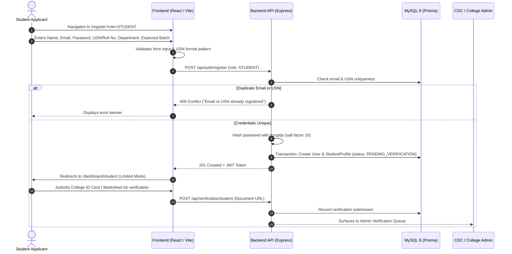
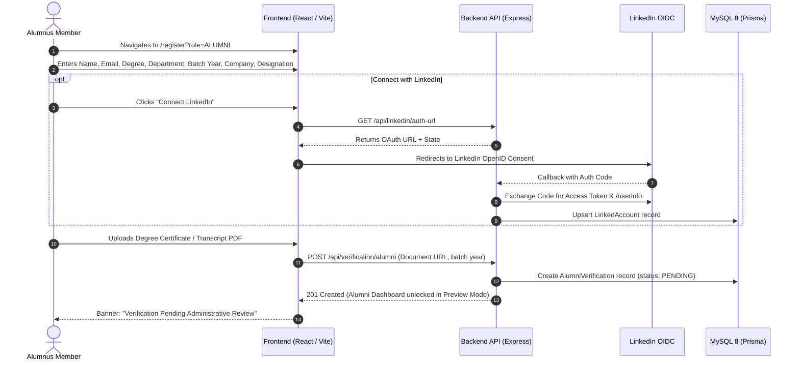
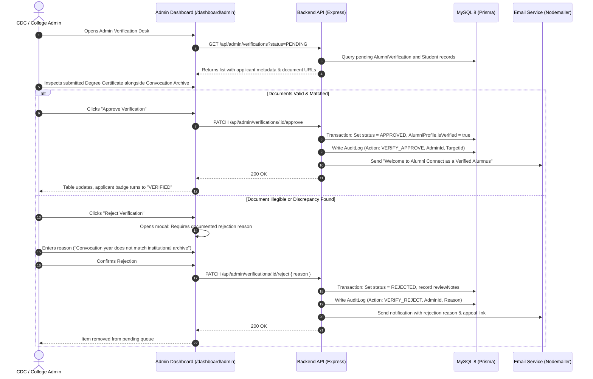
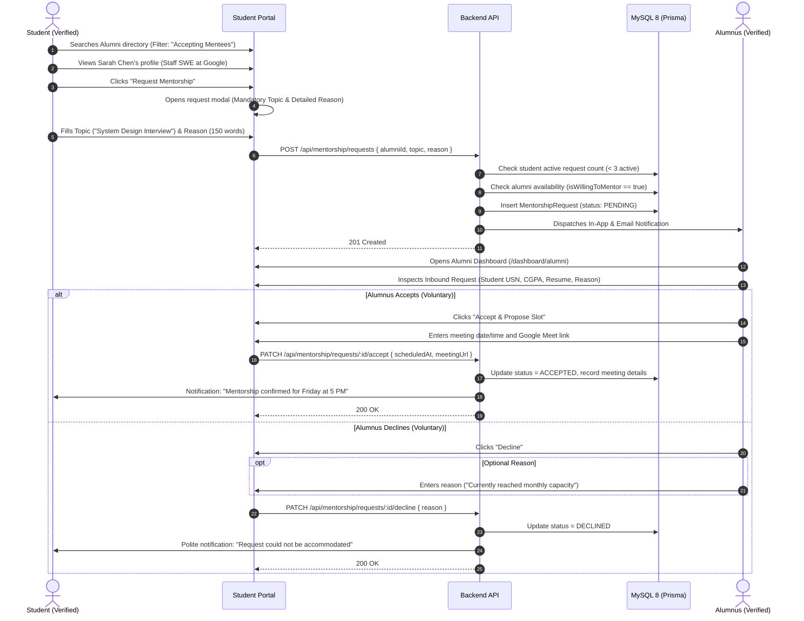
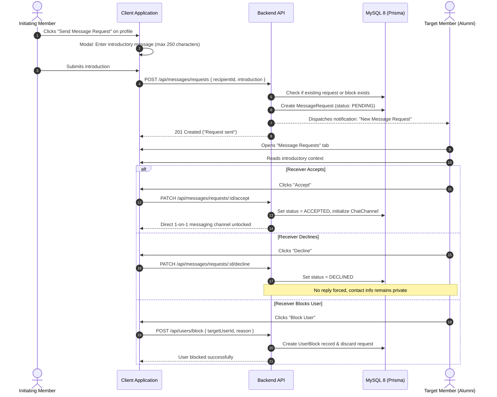
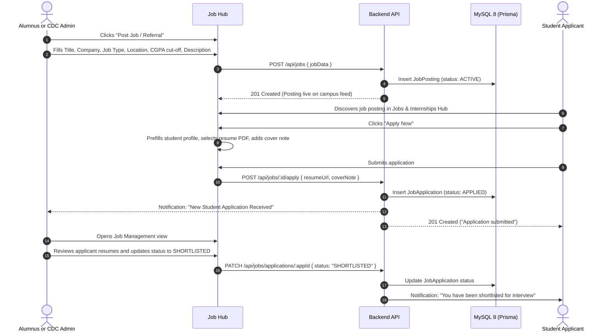
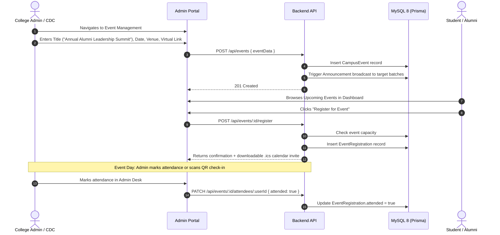

# Alumni Connect — End-to-End User Flows & Interaction Workflows

**Document Version:** 1.0  
**Classification:** Product Experience & Operational Workflows  
**Target Audience:** Frontend Engineers, Backend Engineers, QA Testers, Product Designers  

---

## Table of Contents

1. [Flow 1: Student Registration & Verification](#flow-1-student-registration--verification)
2. [Flow 2: Alumni Registration & Verification](#flow-2-alumni-registration--verification)
3. [Flow 3: Admin Review, Approval & Rejection](#flow-3-admin-review-approval--rejection)
4. [Flow 4: Mentorship Request & Decision Lifecycle](#flow-4-mentorship-request--decision-lifecycle)
5. [Flow 5: Message Request & Communication Gating](#flow-5-message-request--communication-gating)
6. [Flow 6: Job Posting & Application Lifecycle](#flow-6-job-posting--application-lifecycle)
7. [Flow 7: Campus Event Creation & Attendance](#flow-7-campus-event-creation--attendance)
8. [Flow 8: Account Suspension & Due Process Appeal](#flow-8-account-suspension--due-process-appeal)

---

## Flow 1: Student Registration & Verification



### Flow Details
- **Preconditions:** Student is not already registered.
- **Initial State:** `PENDING_VERIFICATION`.
- **Experience in Limited Mode:** Student can view public campus notices, edit their own profile bio and skills, but cannot initiate mentorship requests or apply for jobs.
- **Postconditions:** Account is queued in the Administration Verification Desk.

---

## Flow 2: Alumni Registration & Verification



### Flow Details
- **Preconditions:** Alumnus graduated from the college.
- **Voluntary Rule:** Alumnus specifies whether they want to mentor students (`isWillingToMentor: true/false`) and their monthly mentee capacity (e.g., 2 students/month).
- **Postconditions:** Verification record created in `AlumniVerification` with `PENDING` status.

---

## Flow 3: Admin Review, Approval & Rejection



### Flow Details
- **Accountability Constraint:** Every administrative action requires an immutable `AuditLog` entry.
- **Rejection Mandate:** No rejection can be submitted without a documented reason.

---

## Flow 4: Mentorship Request & Decision Lifecycle



### Flow Details
- **Voluntary Rule:** Alumnus has 100% voluntary discretion. Declining incurs zero platform penalties.
- **No Unsolicited Inboxes:** Request remains quarantined until explicitly accepted.

---

## Flow 5: Message Request & Communication Gating



---

## Flow 6: Job Posting & Application Lifecycle



---

## Flow 7: Campus Event Creation & Attendance



---

## Flow 8: Account Suspension & Due Process Appeal

```mermaid
sequenceDiagram
    autonumber
    actor Reporter as User / System Flag
    participant Server as Backend API
    participant DB as MySQL 8 (Prisma)
    actor Admin as College Admin
    actor Suspended as Suspended User

    Reporter->>Server: Reports abusive conduct or suspicious profile
    Server->>DB: Create AbuseReport, increment anomaly score
    Server-->>Admin: Surfaces to Moderation Queue

    Admin->>Admin: Reviews submitted evidence manually (Human-in-the-Loop)
    alt Action Warranted
        Admin->>Server: POST /api/admin/users/:userId/suspend { reason, duration }
        Server->>DB: Set User.isActive = false, status = SUSPENDED
        Server->>DB: Write AuditLog (Action: ACCOUNT_SUSPEND, AdminId, Reason)
        Server->>Suspended: Sends formal Suspension Notice with specific reason
    end

    Suspended->>Server: Attempts login; redirected to /appeal
    Suspended->>Server: Submits appeal statement and supplemental identification
    Server->>DB: Insert AccountAppeal record (status: PENDING)
    Server-->>Admin: Surfaces to Appeals Queue

    Admin->>Admin: Evaluates appeal statement and verified college documents
    alt Appeal Granted
        Admin->>Server: POST /api/admin/appeals/:id/restore { justification }
        Server->>DB: Set User.isActive = true, status = VERIFIED
        Server->>DB: Write AuditLog (Action: ACCOUNT_RESTORE, AdminId, Justification)
        Server->>Suspended: Dispatches "Account Restored" confirmation email
    else Appeal Denied
        Admin->>Server: POST /api/admin/appeals/:id/deny { finalVerdict }
        Server->>DB: Update AccountAppeal.status = REJECTED
        Server->>Suspended: Dispatches final verdict notification
    end
```

### Flow Details
- **Zero Automated Bans:** Automated algorithms only flag accounts for administrative review; they **never** execute an irreversible ban without human sign-off.
- **Fair Due Process:** Suspended users are always informed of the specific rule violation and given a dedicated path to submit an appeal.
